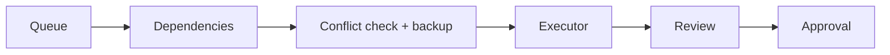

# Multi-AI Hub

**Coordinate AI coding tasks from a local dashboard, with dependencies, cooperative file locks, backups and review.**

[English](#english) · [Português](#português) · [Report a bug](https://github.com/p1v0t/multi-ai-hub/issues) · [Security](SECURITY.md)

Python 3.10+ · Standard library only · Claude / Codex / Grok CLI workflows · Starts paused

## English

Multi-AI Hub helps coordinate work across Claude, Codex and Grok CLI workflows on a local project. Queue tasks, declare the files they concern, wait for dependencies and review results before approval. It is a standalone public edition without private project data or history.

### What it helps you manage

| Need | Built-in workflow |
| --- | --- |
| Divide work between AI tools | Tasks with an executor, instructions and declared files |
| Avoid conflicting edits | Cooperative locks and a conflict check before dispatch |
| Control task order | Dependencies are released only after approval |
| Keep recovery copies | Backups of explicitly listed files and folders before dispatch |
| Review completed work | Cross-review tasks, approval and return-for-correction actions |



The executor must acquire its own session locks before editing. Cooperative locks are agreements between agents, not an operating-system sandbox or access-control boundary.

### Quick start on Windows

**Requirements:** Python 3.10+, Git, and the provider CLIs you intend to use, installed and authenticated separately. Provider tools, credentials and subscriptions are not included. The hub itself has no external Python package dependencies.

Clone this repository:

```powershell
git clone https://github.com/p1v0t/multi-ai-hub.git
cd multi-ai-hub
```

Choose an **existing test project** and a separate private state directory. Replace the example project path with your own:

```powershell
$env:AI_HUB_PROJECT = (Resolve-Path 'D:\projects\demo').Path
$env:AI_HUB_HOME = Join-Path $env:LOCALAPPDATA 'MultiAIHub\demo'
py -3 server.py
```

The dashboard opens at **http://127.0.0.1:8766** and starts **paused on every launch**. Review the queue, configured commands and CLI permissions before resuming. Use `AI_HUB_PORT` for a different port.

On Linux/macOS, set `AI_HUB_PROJECT` and `AI_HUB_HOME` with `export`, using absolute paths, and start with `python3 server.py`. Keep the state directory outside both the target project and this installation.

### Example task

In a terminal with the same environment variables, create a review task for a file that exists in your test project:

```powershell
py -3 hub.py nova --id TASK-001 --titulo "Review example module" --executor codex --arquivos src/demo.py --instrucoes "Review only the specified module and document findings" --regressao "python -m unittest discover -s tests"
py -3 hub.py estado
```

The file and regression command above are examples; adapt them to your project and Python launcher. Resume from the dashboard when ready to execute. The interface and CLI commands currently use Portuguese names.

A completed task moves to review. The coordinator can approve it or return it with feedback. Use `--depende TASK-000` to declare a dependency. See the Portuguese reference below for approval, correction and lock commands.

### Controls and limits

- **Pausing stops new dispatches.** Already running tasks continue. Closing the dashboard does not automatically terminate all child processes.
- **Review CLI commands first.** The private `hub_config.json` in `AI_HUB_HOME` can launch programs with your permissions. Codex defaults to `workspace-write`.
- **Use one dispatcher per state directory.** Use separate `AI_HUB_HOME` directories for different projects.
- **Acquire and renew cooperative locks.** Executors use a unique session name; locks expire after 60 minutes by default.
- **Backups cover declared paths.** Files discovered later by an executor are not automatically backed up by the hub. A backup failure prevents dispatch.
- **Keep runtime data private.** Prompts, logs, outputs, reviews and backups may contain private code or data and do not belong in a public repository.
- **Windows command wrappers are restricted.** `.cmd` and `.bat` executables are rejected; use native executables or explicitly configure the interpreter and entry script. Preserve CLI permission controls.

### Validation and feedback

```powershell
py -3 -m unittest discover -s tests -v
```

Tests use temporary directories, loopback HTTP and a synthetic Python executor. They do not authenticate to providers or start real AI tools. CI runs on Windows/Linux and checks for secrets with Gitleaks. Read [SECURITY.md](SECURITY.md).

[Report a problem](https://github.com/p1v0t/multi-ai-hub/issues) with your OS, Python version, reproduction steps and expected result. Remove credentials and private project data before posting; follow the security policy for security reports.

### Optional Grok web bridge

[Grok CLI ↔ Web Bridge](https://github.com/p1v0t/grok-cli-web-bridge) is a separate program for importing web conversations and reviewing selected CLI messages before sending them to grok.com. Its web planning requires separate authorization; starting the hub does not automatically send conversations. See the Portuguese reference for optional integration settings.

**License:** this publication does not include an additional software license. Public source availability alone does not grant an open-source license.

---

## Português

**Organize tarefas entre IAs pelo painel local, com dependências, travas cooperativas, backups e revisão.**

Coordenador local de tarefas para Claude, Codex e Grok CLI, com fila, dependências, travas cooperativas, backups e revisão cruzada. Edição pública independente, sem dados ou histórico de projetos privados. Python 3.10+; biblioteca padrão, sem pacotes Python externos.

## Começar no Windows

Clone este repositório e abra o PowerShell na pasta clonada. Escolha **um projeto de teste**:

```powershell
$env:AI_HUB_PROJECT = (Resolve-Path 'D:\projetos\demo').Path
$env:AI_HUB_HOME = Join-Path $env:LOCALAPPDATA 'MultiAIHub\demo'
py -3 server.py
```

Os caminhos são exemplos: use diretórios seus. O projeto precisa existir e o diretório de estado deve ficar fora do projeto e desta instalação. No Linux/macOS, use `export AI_HUB_PROJECT=/caminho/absoluto/demo`, `export AI_HUB_HOME=/caminho/absoluto/estado` e `python3 server.py`.

O painel abre em `http://127.0.0.1:8766` e começa **pausado em cada inicialização**. Para outra porta, configure `AI_HUB_PORT`. Só retome depois de revisar a fila, os comandos configurados e as permissões dos CLIs. Pausar interrompe novos despachos; tarefas que já executam continuam. Encerrar o painel também não mata automaticamente todos os processos filhos.

## Criar e revisar uma tarefa

Na mesma sessão de terminal, com as mesmas variáveis:

```powershell
py -3 hub.py nova --id TASK-001 --titulo "Revisar módulo de exemplo" --executor codex --arquivos src/demo.py --instrucoes "Revisar somente o módulo indicado e documentar os achados" --regressao "python -m unittest discover -s tests"
py -3 hub.py estado
```

Retome pelo painel quando quiser executar. Uma tarefa concluída passa para revisão. A revisão cruzada gera outra tarefa para a outra IA. A aprovação automática dos pareceres começa desligada; o coordenador decide:

```powershell
py -3 hub.py aprovar TASK-001 --nota "Entrega e testes conferidos"
py -3 hub.py devolver TASK-001 --parecer "Descrever a correção necessária"
```

Dependências usam `--depende TASK-000`; só liberam após aprovação. Após duas devoluções, a tarefa passa para Claude/coordenador. `hub.py assumir ID --agente nome-unico` permite execução manual. `hub.py ciclo` roda um ciclo; não inicia um serviço contínuo. `hub.py auto on` apenas muda a configuração, não cria o serviço.

## Configuração e execução

O primeiro uso cria `hub_config.json` em `AI_HUB_HOME`. Esse arquivo é privado e controla os executáveis. Os CLIs devem estar instalados e autenticados pelo próprio usuário. A instalação não inclui ferramentas, credenciais ou assinaturas dos provedores.

- Codex usa `workspace-write` por padrão. O caminho de um executável nativo pode ser configurado em `cmd.codex`.
- Grok usa seu executável no PATH, ou a descoberta da ponte quando ela estiver disponível.
- No Windows, wrappers `.cmd`/`.bat` são recusados para impedir interpretação de argumentos pelo shell. Use um executável nativo ou configure explicitamente o interpretador e o script de entrada. Não desative controles de permissão do CLI para contornar erros.
- Cada entrada de `cmd` é uma lista de argumentos, com substituições `{proj}`, `{prompt}` e `{grok}`. Configuração é código confiável: pode iniciar programas com suas permissões.
- Backups de arquivos e pastas explicitamente listados ficam em `AI_HUB_HOME/backups`, separados por tarefa e tentativa. Falha de backup impede despacho. Arquivos descobertos posteriormente pelo executor não têm backup automático pelo hub.
- Saídas, prompts, logs, revisões e backups podem conter código e dados privados. Eles nunca pertencem ao repositório público.

## Travas cooperativas

O executor deve adquirir as travas **no nome único da sua sessão** antes de editar. O hub consulta conflitos antes do despacho, mas não substitui essa aquisição. Use o `trava.py` desta instalação com as mesmas variáveis de ambiente:

```powershell
py -3 trava.py pegar src/demo.py --agente codex-sessao-exemplo --tarefa TASK-001
py -3 trava.py renovar --agente codex-sessao-exemplo
py -3 trava.py liberar src/demo.py --agente codex-sessao-exemplo
```

Há também `tarefa-nova`, `tarefa-assumir`, `tarefa-pausar`, `tarefa-retomar` e `tarefa-concluir` para registro independente no gerenciador de travas. Travas expiram por padrão após 60 minutos; renove tarefas longas. São acordos entre agentes, **não uma sandbox nem controle de acesso do sistema operacional**. Só um despachante deve usar cada `AI_HUB_HOME`; use diretórios separados para projetos distintos.

## Ponte Grok opcional

A [ponte CLI/web](https://github.com/p1v0t/grok-cli-web-bridge) é um programa independente. Se desejar os auxiliares de canais deste hub, inclua a pasta da ponte em `PYTHONPATH` e mantenha o mesmo `GROK_BRIDGE_HOME`. Planejamento pela web precisa ser autorizado separadamente. O hub não envia conversas automaticamente ao iniciar.

## Verificação

```powershell
py -3 -m unittest discover -s tests -v
```

Os testes usam diretórios temporários, requisições HTTP em loopback e um executor Python sintético. Não autenticam nos provedores e não iniciam IAs reais. A CI executa os testes em Windows/Linux e verifica segredos com Gitleaks. Leia [SECURITY.md](SECURITY.md) antes de usar com dados sensíveis.

Esta publicação não inclui uma licença de uso adicional. A publicação do código, por si só, não concede uma licença de software livre.
